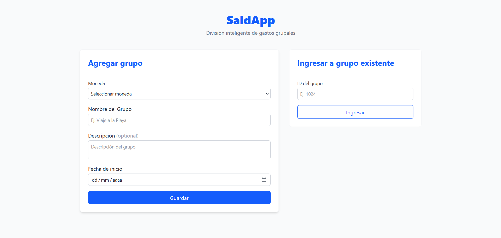
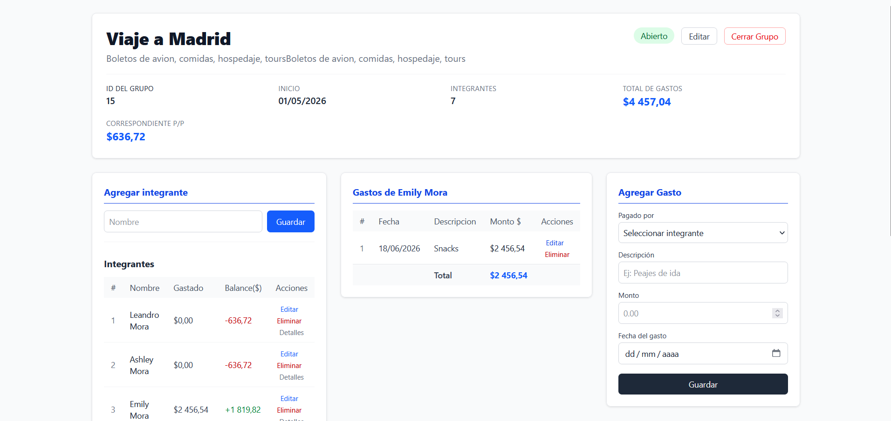
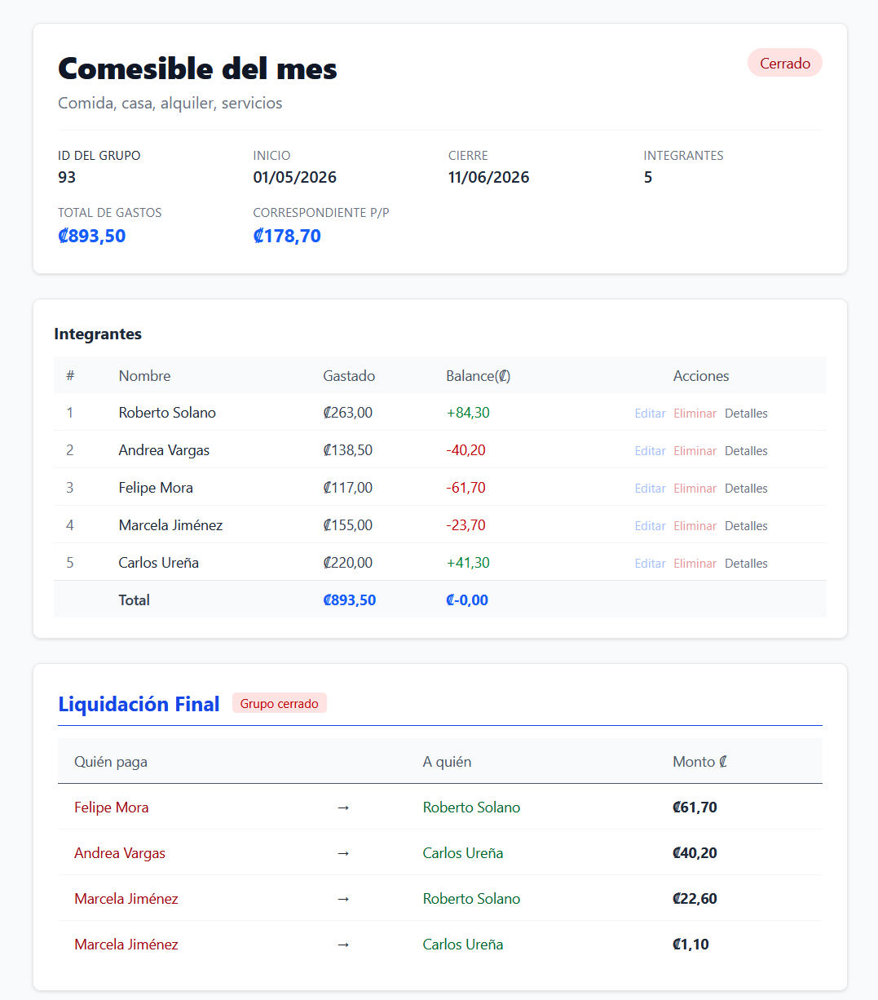

# SaldApp — Frontend

> Read in English: [README.md](README.md)

Aplicación web para dividir gastos grupales. Creas un grupo, agregas integrantes y gastos, y ves de un vistazo quién le debe a quién. Backend complementario: [saldapp-backend](https://github.com/leandro-mc/saldapp-backend).

## Vista previa

<p>
  
</p>
<p>
  
</p>
<p>
  
</p>

## Funciones

- Crear y gestionar grupos, integrantes y gastos
- Balance en vivo por integrante y plan de liquidación con el mínimo de pagos
- Los grupos cerrados pasan a una vista de solo lectura
- Estados de carga, error y confirmación manejados de forma consistente

## Tecnologías

- React 19 y Vite
- React Router 7
- Axios con un interceptor global que normaliza los errores de la API
- Tailwind CSS 4
- ESLint

## Cómo ejecutarlo

Requisitos: Node.js 22+ y el [backend](https://github.com/leandro-mc/saldapp-backend) corriendo en `http://localhost:8080`.

```bash
git clone https://github.com/leandro-mc/saldapp-frontend.git
cd saldapp-frontend
cp .env.example .env     # VITE_API_BASE_URL apunta al backend
npm install
npm run dev              # http://localhost:5173
```

## Estructura

```
src/
├── pages/        # HomePage, GroupPage
├── components/   # UI por dominio: group, expense, integrant, settlement, shared
├── hooks/        # Lógica de datos y estado (useGroup, useExpense, ...)
├── services/     # Llamadas a la API por recurso
├── config/       # Cliente Axios
└── utils/        # Dinero, fechas, parseo de errores
```
