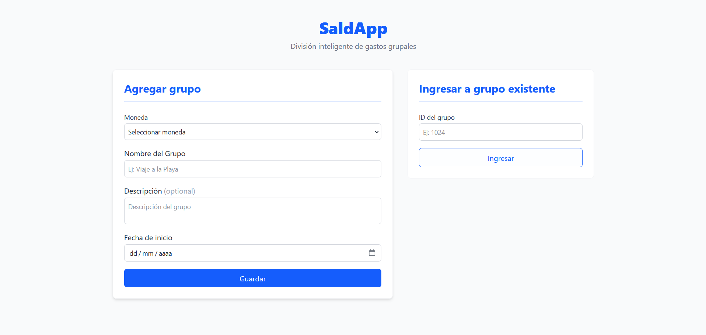
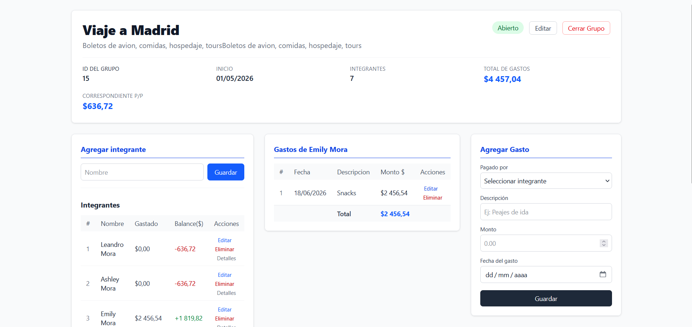
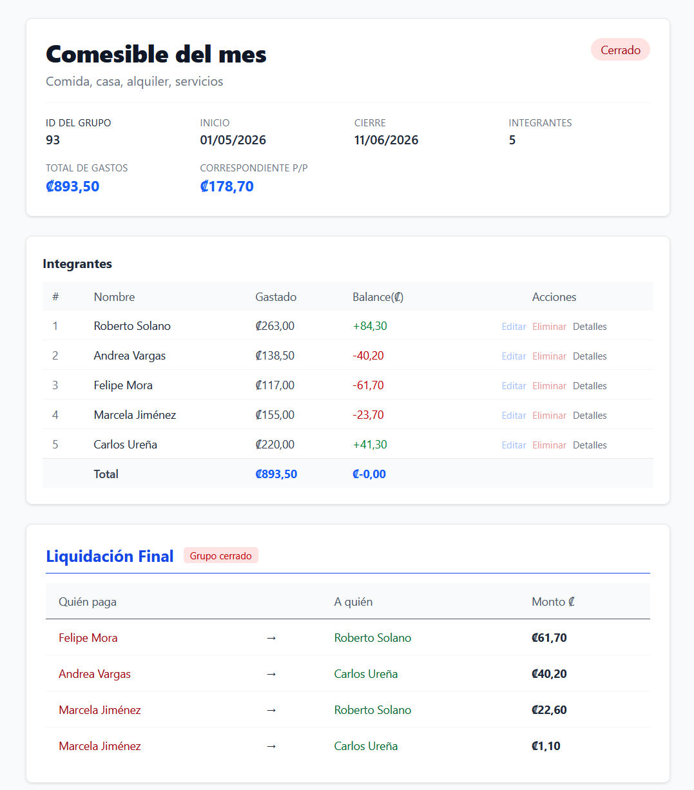

# SaldApp — Frontend

> Leer en español: [README.es.md](README.es.md)

Web app for splitting group expenses. Create a group, add members and expenses, and see who owes whom at a glance. Companion backend: [saldapp-backend](https://github.com/leandro-mc/saldapp-backend).

## Preview

<p>
  
</p>
<p>
  
</p>
<p>
  
</p>

## Features

- Create and manage groups, members and expenses
- Live balance per member and a settlement plan with the minimum payments
- Closed groups switch to a read-only view
- Loading, error and confirmation states handled consistently

## Tech stack

- React 19 and Vite
- React Router 7
- Axios with a global interceptor that normalizes API errors
- Tailwind CSS 4
- ESLint

## Getting started

Requirements: Node.js 22+ and the [backend](https://github.com/leandro-mc/saldapp-backend) running on `http://localhost:8080`.

```bash
git clone https://github.com/leandro-mc/saldapp-frontend.git
cd saldapp-frontend
cp .env.example .env     # VITE_API_BASE_URL points to the backend
npm install
npm run dev              # http://localhost:5173
```

## Structure

```
src/
├── pages/        # HomePage, GroupPage
├── components/   # UI by domain: group, expense, integrant, settlement, shared
├── hooks/        # Data and state logic (useGroup, useExpense, ...)
├── services/     # API calls per resource
├── config/       # Axios client
└── utils/        # Money, dates, error parsing
```
